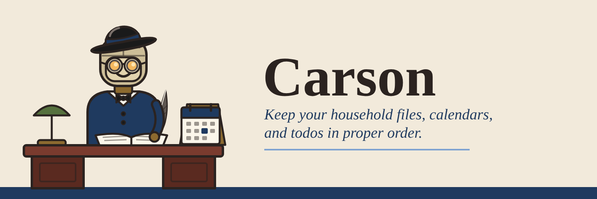

# Carson

A household filing and admin assistant for Claude, for people who would rather not think about paperwork.

You hand Carson a document: a bill, a letter, an insurance policy, a photo of something that came in the mail. Carson reads it, files a clearly named copy in the right folder on your computer, writes a short note on what matters, and tells you if something needs doing. Later, you ask "where is my car insurance policy?" or "when does my passport expire?" and Carson answers from what is on file.

Carson is built for people who are comfortable with email and a web browser and not much else. It asks one question at a time, in plain words.

**Status: early test build (0.15.1).** This version covers setup, filing, the daily and weekly routines, Carson's Desk, a household budget, papers kept either in Google Drive or in a folder on a computer, papers you already had, shared households, and house procedures. It has been tested by its author only; the newest parts have not yet been tried by other people. Expect rough edges.

## What Carson does

- **Works with the papers you already have.** Keep your own folders as they are, or let Carson organize them: it copies your papers into a tidy new folder and leaves your old folder untouched.
- **Works for a household.** Each adult can run their own Carson on the same folder, with their own inbox, todos, briefings, and desk. Carson offers a family event to the others it concerns, and learns who wants to hear about what.
- **Keeps count of weekly goals,** if you want it to: tap a box on your Desk each time you exercise, and Carson tells you midweek if you are behind.
- **Sets itself up by interview.** Say "set up Carson" and answer about fifteen minutes of simple questions. Carson builds your folders around your household.
- **Files your documents.** Attach a file or photo in the conversation, drop it in the inbox folder, or forward it to your own Carson email address (Gmail only for now).
- **Keeps short notes.** One index note per topic, plus a summary beside each important document.
- **Suggests todos and calendar events,** and adds them only after you say yes. Works with Todoist, Google Calendar, and Outlook, or keeps its own simple lists.
- **Briefs you each morning,** if you like: what is on today, what is due, and what it filed. An optional evening look back says what got done.
- **Keeps a desk for you.** Carson's Desk is a private page showing what's on today, your todos with boxes to tick, and Carson's suggestions with Yes and No buttons.
- **Keeps a simple budget,** if you like. You set a plan; Carson adds up what you spent from your bank statements (or from Tiller) and shows both on a private page, month by month and for the year. Carson only reads. It never moves money and never gives financial advice.
- **Keeps itself tidy.** A weekly check makes sure the notes match the folders.
- **Learns your preferences.** Tell Carson when it gets something wrong and it will remember. It learns only from what you tell it and from its own notes in your folder; it does not read Claude's memory or your past conversations.

## What Carson never does

- Carson never deletes anything.
- Carson never sends email or messages to anyone.
- Carson never pays a bill or moves money.

## What you need

- A paid Claude plan and the Claude desktop app.
- A place for your papers, chosen in setup. Either a folder in your Google Drive, or a folder on your computer (a new, empty folder named "Carson" is best).
- **If you choose a folder on your computer:** Carson can reach your papers, and its scheduled routines run, only while that computer is switched on, awake, and connected to the internet, with the Claude app open. With Google Drive, nothing has to be left on.
- Optional: Gmail or Outlook, Google Calendar or Outlook calendar, and Todoist, connected to Claude.

## Getting started

1. Add the Carson plugin to Claude. The step-by-step guide is at https://bartlebot.com/carson/.
2. Start a new conversation and choose your Carson folder.
3. Type: `set up Carson`

After setup, the things you will say most are "file this," "check my inbox," and "where is my…?" Setup leaves a one-page guide called "How to use Carson" in your folder.

To take a break or stop, say "pause Carson" or "stop Carson." Carson turns off its routines and tells you what is left. Your documents and notes stay where they are.

## Please read

- **Carson is not a financial, tax, legal, or medical adviser.** It organizes and summarizes. It does not tell you what to do with your money, your taxes, your health, or your legal affairs.
- **A shared folder is shared in full.** If you share Carson with others in your household, everyone can open every paper in the folder, including health and money papers. Carson cannot keep one person's papers from another. Keep anything private outside the folder.
- **Carson can make mistakes.** Check dates, amounts, and deadlines against the original document before you rely on them.
- **You are responsible for your own security.** That means your computer, your Claude and email accounts, your Carson folder, and your backups. Use a strong password and two-step sign-in on your Claude and email accounts.
- **Your documents are read by Claude,** the AI service you are signed in to, under your own Claude plan and Anthropic's terms and privacy policy. Apps you connect (Google, Microsoft, Todoist) work under their own terms.
- **No warranty.** Carson is free software, provided as is. See the license.

## Privacy

Carson has no server and no account of its own. It sends nothing to its author. Everything Carson knows about you is in plain files in your own Carson folder, which you can read, edit, move, or delete at any time.

The only personal information the author ever holds is an email address you choose to share by writing for support. It is used to answer you and, if you ask, to tell you about updates. It is never used for marketing and never shared.

## How it is built

Carson is a set of plain-text instructions (skills), note templates, two web page templates (Carson's Desk and Carson's Budget), and one short program, `budget.py`, that does the budget arithmetic. The program reads your two budget files and writes one file of results; it uses no network and changes nothing else. Carson includes no servers and no hidden instructions; every file is readable. Each page keeps its data in a private database attached to that page in your own Claude account. If you use the budget, that includes your spending figures and, unless you choose totals only, your individual purchases. The Desk reads your Todoist tasks only if you use Todoist and allow it.

| Skill | Purpose |
|---|---|
| `setup` | The setup interview; also changes your choices later |
| `file` | Reads, files, and notes each document |
| `files` | How Carson reads, names, and moves files safely |
| `tasks-and-dates` | How Carson handles todos and calendar events for the apps you chose |
| `brief` | The morning briefing |
| `review` | The evening look back |
| `tidy` | Checks that the folder is in order and accurate |
| `learn` | Turns your corrections into standing rules, after you agree |
| `desk` | Builds and refreshes Carson's Desk |
| `money` | Keeps the budget files and builds Carson's Budget |
| `help` | Answers questions about using Carson |

## Support

Questions and problems: hello@bartlebot.com

## License

Copyright © 2026 Amy E. Tabor.

Carson is free software: you can redistribute it and/or modify it under the terms of the GNU General Public License as published by the Free Software Foundation, either version 3 of the License, or (at your option) any later version. Carson is distributed in the hope that it will be useful, but WITHOUT ANY WARRANTY; without even the implied warranty of MERCHANTABILITY or FITNESS FOR A PARTICULAR PURPOSE. See the `LICENSE` file for the full text.

## Also by the author

Lawyers may be interested in BartleBot, a litigation toolkit for Claude: https://bartlebot.com
